# How much stock should we hold? Inventory planning & demand forecasting

Demand forecasting and inventory optimisation for the top 150 products of a **real** UK online gift retailer
(UCI Online Retail II, Dec-2009 to Nov-2011): ABC–XYZ classification, a forecast backtest, safety stock, reorder points, EOQ,
min/max levels and the working-capital impact, in SQL, an Excel what-if model and Power BI.

> **Business question:** *How much stock should we hold for each product, and when should we reorder, so we don't run out or overstock?*
>
> **How it connects:** my previous project analysed this retailer's **returns**; this one plans its **stock**, using the same
> data and the same cleaning rules.
>
> Built with help from a friend; I'm using it to learn forecasting and inventory planning.

**Tools:** Excel (live formulas, what-if inputs) · SQL (MySQL 8: CTEs, window functions) · Power BI (DAX, 4 pages, what-if slicers) · Python/pandas for data prep only

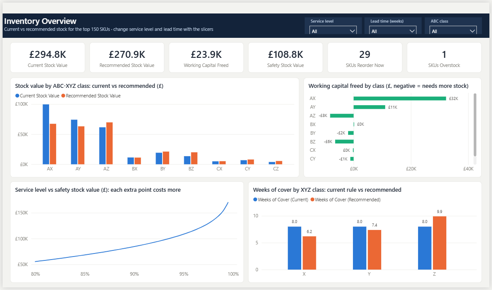

---

## Headline results (95% service level, 3-week lead time)

| Current stock (assumed) | Recommended avg stock | Working capital freed | Holding cost saved / yr | SKUs to reorder now | Forecast bias (chosen methods) |
|---|---|---|---|---|---|
| £294.8k | £270.9k | **£23.9k (8.1%)** | £6.0k | 29 | **+4%** (vs −22% for SES) |

- **The blanket "8 weeks of cover for everything" rule is wrong in both directions.** It holds £32k too much of steady (X) products
  and £16k too little of erratic (Z) products. 26 of the 29 products to reorder now are erratic Z items. The policy *moves* stock
  to where the risk is, rather than just cutting it.
- **Flat forecasts miss Christmas.** Naive, moving average and SES all under-forecast the Sep–Nov 2011 run-up by 20–35%.
  Holt-Winters expects the rise; choosing the best method per ABC–XYZ class gives a bias of just +4% at a similar WAPE (61%).
- **Holt-Winters wins for variable, valuable products** (AY, AZ, BY, BZ); smooth methods win for steady products and small erratic ones.
- **Service level gets expensive fast:** 95% → 99% needs about 40% more safety stock (£108.6k → £153.6k).
- **A is a big class (95 of 150)** because the range is already the top sellers: 63% of these products make 80% of their value.

| Weekly demand of the 150 SKUs vs the backtest forecasts | Forecast error score by class (lower = better) |
|---|---|
| 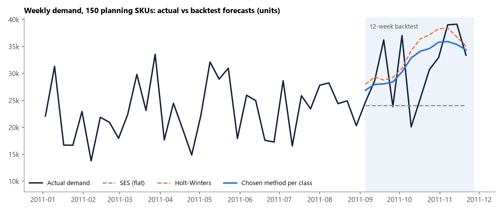 | 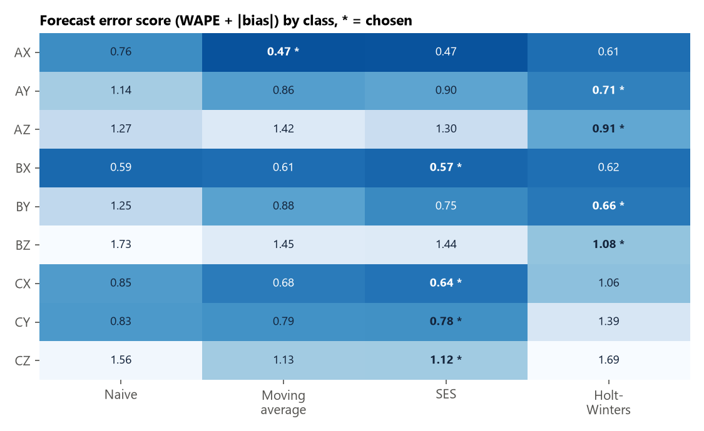 |

---

## Assumptions (the data has no lead times, costs or stock levels)

All of these are **inputs** in the Excel model (sheet *Inputs*) and slicers or measures in Power BI, so they are easy to change.

| Assumption | Default | Why |
|---|---|---|
| Service level | **95%** (z = NORM.S.INV(0.95) = 1.645) | the brief's target; can be set per ABC class |
| Lead time | **3 weeks** | middle of the 2–4 week range for imported giftware |
| Holding cost | **25% of unit cost per year** | capital, storage, insurance, damage, obsolescence (typical 20–25%) |
| Ordering cost | **£50 per order** | admin, freight booking and goods-in for one purchase order line |
| Unit cost | **60% of the average selling price** | the data only has selling prices; = a 40% gross margin |
| Current stock | **8 weeks of average demand, every SKU** | no stock data, so "today" is a blanket weeks-of-cover rule; replace with a real stock file |
| Demand history | weekly, net of returns, 7-Dec-2009 to 27-Nov-2011 | December 2011 (only 9 days) and the partial weeks at both ends are left out |

Other choices: top 150 regular SKUs (sold in ≥ 69 of 103 weeks), ABC 80/15/5 on net sales value, XYZ CV limits 0.75 / 1.25
(weekly data is noisier than the monthly data textbook limits are for), seasonal = Christmas uplift ≥ 1.3.

---

## What's in it

### 1. Excel model (`excel/Inventory_Planning_Model.xlsx`)
Real formulas throughout, no pasted results: change any yellow input and every sheet recalculates.

| Sheet | What it does | Functions to look at |
|---|---|---|
| Inputs | service level, lead time, costs, current stock, class limits (data validation on every input) | `NORM.S.INV`, named ranges |
| Summary | KPIs, results by ABC and XYZ class, service level vs cost table, top-10 reorder list | `SUMIFS`, `COUNTIFS` with wildcards, `SUMPRODUCT`, `LARGE` + `INDEX/MATCH` |
| Charts | selected-SKU forecast chart, stock by class, trade-off curve, 9-box, Pareto, error by class | |
| ABC_XYZ | cumulative value share, CV, classes, 9-box matrix | `SUMIFS`, `RANK.EQ`, `XLOOKUP`, `STDEV.S`, `COUNTIFS` |
| Forecast | **SKU drop-down**; naive, moving average, SES and Holt-Winters week by week, plus `FORECAST.ETS`; WAPE, MAPE, bias | `INDEX/MATCH`, `XLOOKUP`, `FORECAST.ETS` |
| Backtest | class-level accuracy of all methods, best method per class | `SUMIFS`, `INDEX/MATCH` + `MIN` |
| Policy | safety stock, reorder point, EOQ, min/max, weeks of cover, stock-out risk, order suggestion for all 150 SKUs | `SUMIFS` (3 criteria), `ROUNDUP`, `SQRT`, `NORM.S.DIST` |

| Inputs sheet | Forecast sheet (pick any SKU) |
|---|---|
| 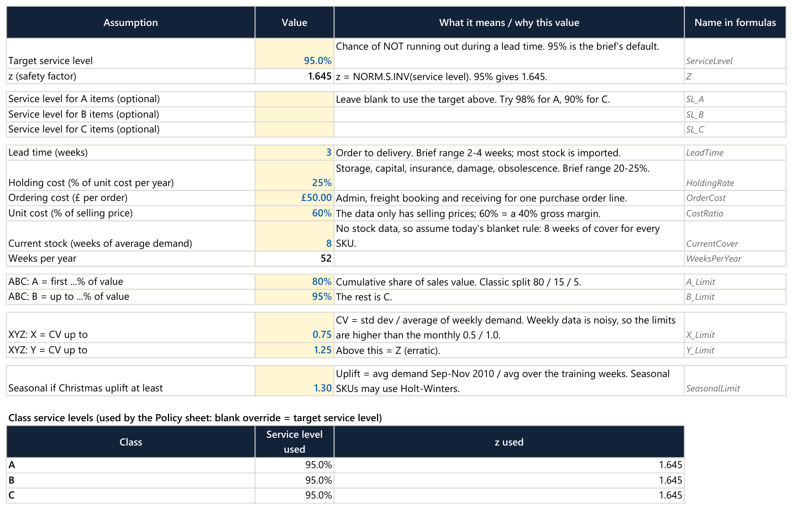 | 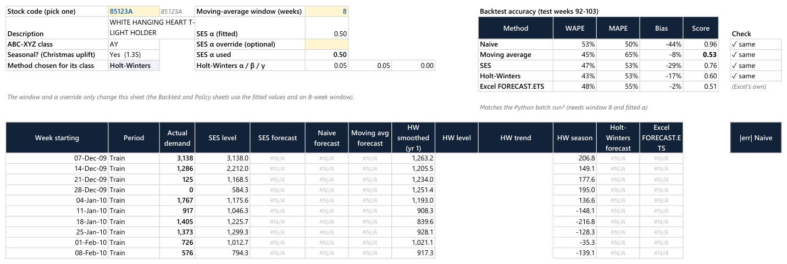 |

| Selected SKU: actual vs the four methods and FORECAST.ETS | Service level vs safety stock | Stock by XYZ class |
|---|---|---|
| 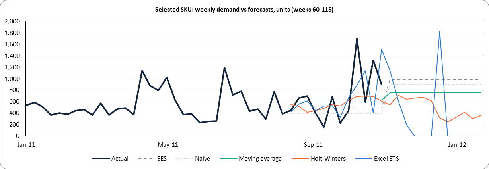 | 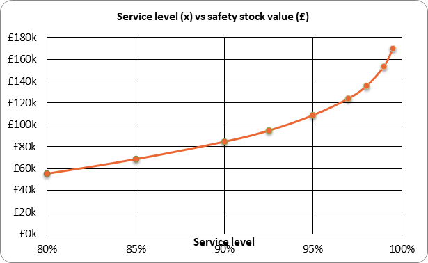 | 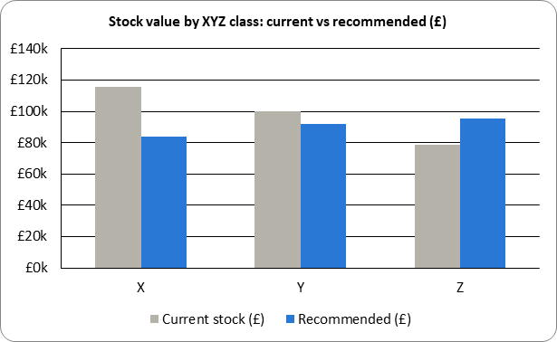 |

### 2. SQL (`sql/`, MySQL 8)
| File | Business questions |
|---|---|
| `01_create_schema.sql` | tables and `LOAD DATA` |
| `02_weekly_demand.sql` | weekly net demand per SKU with zero weeks filled in (recursive CTE calendar check, `CROSS JOIN` grid), the top-150 selection (`ROW_NUMBER`), rolling 4-week average |
| `03_abc_xyz.sql` | ABC by running value share (`SUM() OVER`), XYZ by CV (`STDDEV_SAMP`), 9-box, Pareto, `NTILE` quintiles, `PERCENT_RANK`, most erratic per class (`RANK … PARTITION BY`) |
| `04_demand_patterns.sql` | 4/13-week rolling averages, `LAG`/`LEAD`, year-on-year with `LAG(…, 52)`, Christmas peak, longest zero-demand run (gaps and islands) |
| `05_forecast_backtest.sql` | naive and moving-average backtest in SQL, WAPE / bias / MAPE by method and class, best method per class |
| `06_inventory_policy.sql` | assumptions table, safety stock, reorder point, EOQ, min/max, weeks of cover per SKU |
| `07_business_impact.sql` | current vs recommended stock, working capital, reorder and overstock lists, service level vs cost |

Each query has a one-line comment saying which business question it answers. `python scripts/run_sql_tests.py` runs all 33
queries on DuckDB (no MySQL server needed) and reconciles SQL with Python: same weekly demand, same 150 SKUs, same ABC–XYZ classes,
same best method per class. The Excel model and Power BI give the same policy numbers as SQL for every SKU.

### 3. Power BI (`powerbi/Inventory_Planning.pbip`)
Four pages with **service level and lead time slicers** that recalculate every policy measure (DAX `SUMX` over SKUs, `NORM.S.INV`).
Details in [powerbi/README.md](powerbi/README.md).

| ABC-XYZ Matrix | Forecast vs Actual |
|---|---|
| 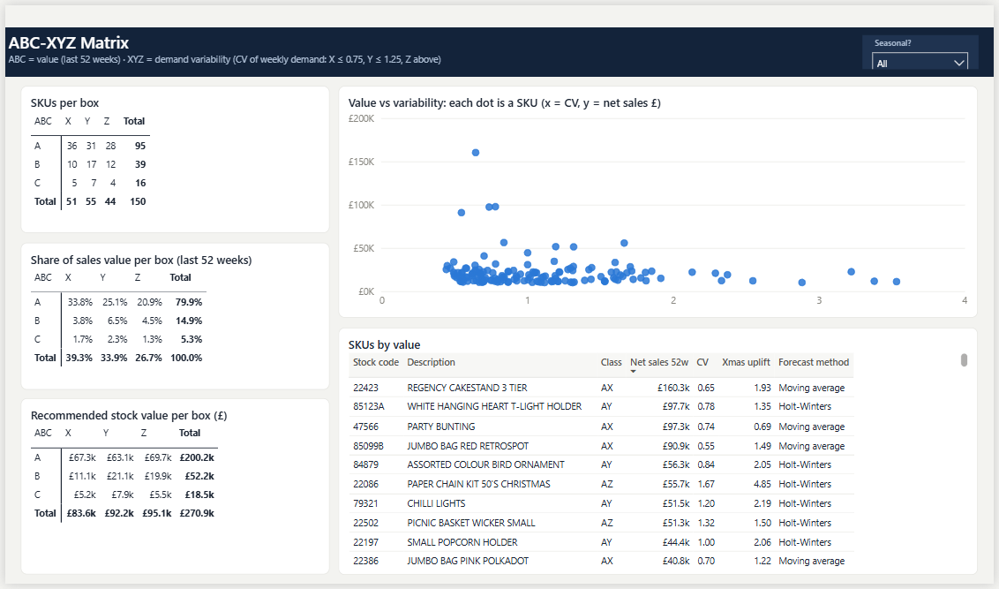 | 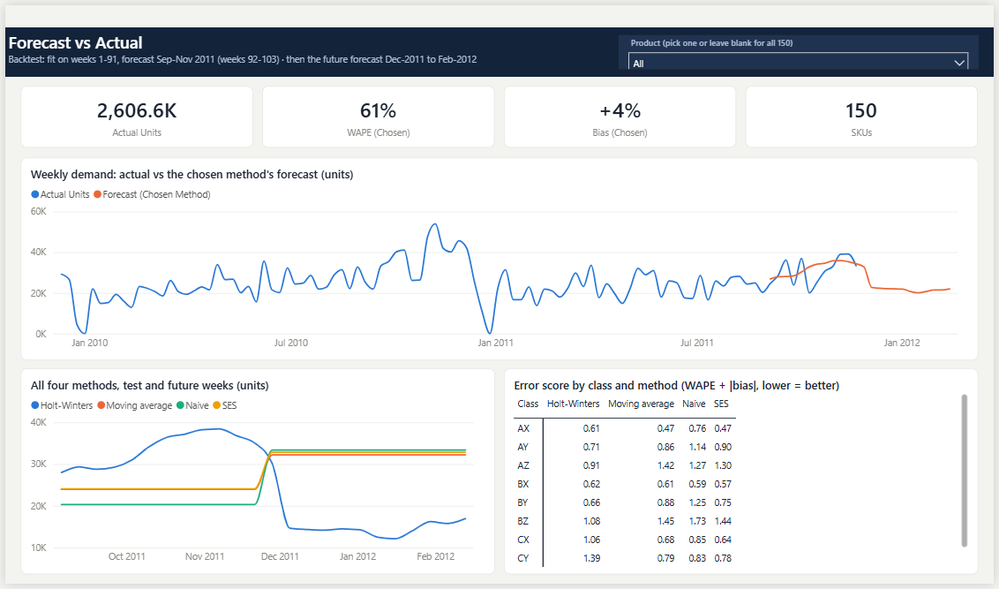 |

| Reorder & At-risk SKUs |
|---|
| 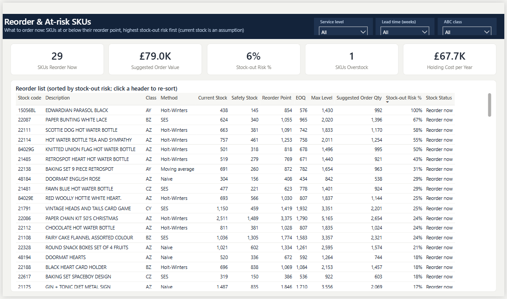 |

### 4. Python, data prep only (`notebooks/`)
- `01_data_prep.ipynb`: cleaning (same rules as the returns project), weekly calendar, net demand, top-150 selection, SKU statistics, ABC–XYZ.
- `02_forecast_backtest.ipynb`: runs the same four forecast formulas as the Excel *Forecast* sheet for all 150 SKUs (the recursive
  methods can't be done in SQL), so Power BI and SQL have every SKU's forecast. Simple loops, no machine-learning libraries.

### 5. Learning notes (`docs/`)
- [walkthrough.md](docs/walkthrough.md): every step in simple English
- [glossary.md](docs/glossary.md): safety stock, EOQ, MAPE, WAPE, bias, service level, CV, z and more
- [interview_qa.md](docs/interview_qa.md): 20 likely interview questions with answers
- [data_dictionary.md](docs/data_dictionary.md): every table and column

---

## How it fits together

```
UCI download ─► 01_data_prep.ipynb ─► weekly demand, SKU list, ABC-XYZ ─┬─► 02_forecast_backtest.ipynb ─► forecasts, accuracy
 (data/raw)      cleaning log                (data/processed)            │
                                                                         ├─► sql/        (rebuilds and checks the tables, policy, impact)
                                                                         ├─► excel/      (what-if model, live formulas)
                                                                         └─► powerbi/    (4-page report, what-if slicers)
```

```
├── data/
│   ├── raw/          downloaded file (not in Git, see data/raw/README.md)
│   └── processed/    planning tables (in Git) + order_lines.csv (rebuilt by notebook 01, not in Git)
├── docs/             walkthrough, glossary, interview Q&A, data dictionary, images
├── excel/            Inventory_Planning_Model.xlsx
├── notebooks/        01 data prep · 02 forecast backtest
├── powerbi/          Inventory_Planning.pbip (+ .SemanticModel / .Report)
├── scripts/          download_data.py, run_sql_tests.py
└── sql/              01 schema … 07 business impact
```

## How to run it

The Excel model and Power BI work straight away: the planning tables are already in `data/processed/`.
To rebuild everything from the raw data:

```bash
pip install -r requirements.txt
```

```bash
python scripts/download_data.py
```

```bash
jupyter nbconvert --to notebook --execute --inplace notebooks/01_data_prep.ipynb notebooks/02_forecast_backtest.ipynb
```

```bash
python scripts/run_sql_tests.py
```

- **SQL on MySQL:** from the repo root run `mysql --local-infile=1 -u <user> -p < sql/01_create_schema.sql`, then files 02–07 in order.
- **Power BI:** open `powerbi/Inventory_Planning.pbip`, point the `DataFolder` parameter at your `data\processed\` folder
  (Transform data › Edit parameters, ending with `\`), then Refresh.

## Limitations
- Costs, lead time and current stock are assumptions; the £ impact depends on them, the method doesn't.
- Sales are not true demand when stock runs out (censored demand), and there is only one Christmas before the test period.
- A few settings (Holt-Winters' 9-week smoothing, the 8-week moving average) were settled after looking at test results; strictly
  they should be tuned on a separate validation period.
- The policy assumes a fixed lead time, continuous review and normally distributed demand. Next steps: safety stock from forecast
  error (RMSE), lead-time variability, Croston's method for the lumpiest products.

## Data source and licence

Chen, D. (2019). *Online Retail II* [Dataset]. UCI Machine Learning Repository. https://doi.org/10.24432/C5CG6D.
Licensed under CC BY 4.0.
